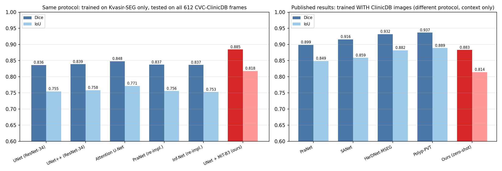
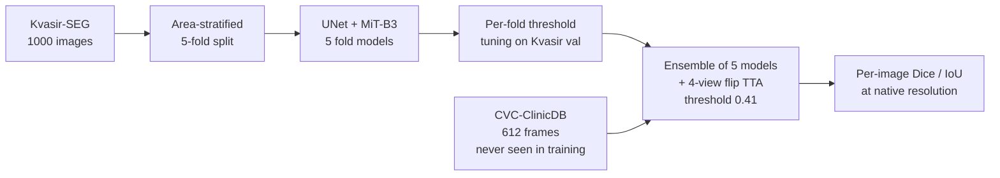
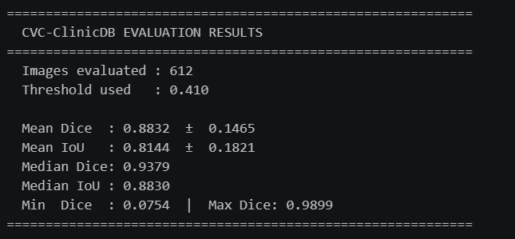
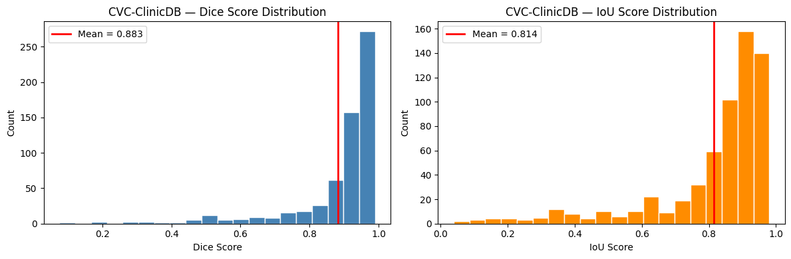
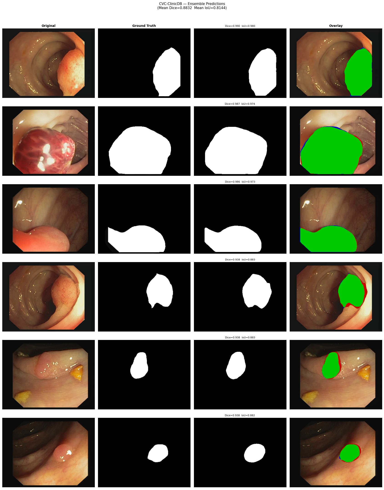
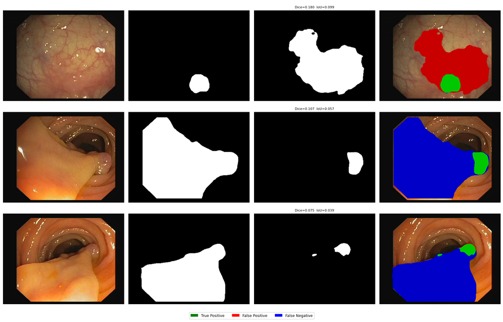
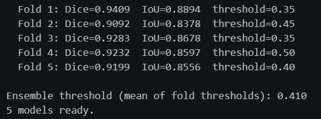

# Transformer-Based Robust Polyp Segmentation for Cross-Dataset Colonoscopy Analysis

**Kunal Shaw** (CS23B1039) · Indian Institute of Information Technology (IIIT) Raichur
**Supervisor:** Dr. Kaushiki Roy
Mini-project, *Deep Learning for Medical Image Processing* (2026)

> A U-Net decoder with a **MiT-B3 (Mix Transformer) encoder**, trained **only on Kvasir-SEG** and tested **zero-shot on all 612 frames of CVC-ClinicDB**, a dataset that is never used for training, checkpoint selection or threshold tuning.

---

## Abstract

Polyp segmentation models are usually reported on test images drawn from the same datasets they were trained on, which says little about behaviour on a new hospital, scope or recording setup. This project asks the harder question: *how well does a polyp segmenter transfer to a dataset it has never seen?*

We train a U-Net with a SegFormer-style Mix Transformer (MiT-B3) encoder on the 1000 images of Kvasir-SEG using area-stratified 5-fold cross-validation, a Dice + BCE + Lovász-hinge loss, EMA weights, a lower learning rate for the pretrained encoder, and per-fold threshold tuning. The five fold models are ensembled with 4-view flip test-time augmentation and evaluated on **CVC-ClinicDB (612 frames, none seen in training)**, reaching **Dice 0.883 / IoU 0.814** (per-image mean, native resolution, median Dice 0.938). Under an identical Kvasir-only protocol, five CNN baselines (U-Net, U-Net++, Attention U-Net and re-implementations of PraNet and Inf-Net) reach 0.836 – 0.848 Dice on the same frames. We also report failure cases and the limits of the evidence.

## Headline results

| Evaluation | Dice | IoU | Notes |
|---|---|---|---|
| **CVC-ClinicDB, zero-shot** (612 frames, native resolution, threshold 0.41) | **0.8832** ± 0.1465 | **0.8144** ± 0.1821 | median Dice 0.9379, median IoU 0.8830; per-image mean ± std |
| CVC-ClinicDB, same ensemble, network resolution (384 px), threshold 0.5 | 0.8848 | 0.8180 | protocol used for the like-for-like baseline table below |
| Kvasir-SEG, 5-fold CV (mean ± std over folds) | 0.9243 ± 0.0104 | 0.8621 ± 0.0169 | development estimate, see [Limitations](#limitations-and-threats-to-validity) |



*Left: all models trained on Kvasir-SEG only and tested on all 612 CVC-ClinicDB frames. Right: published numbers from models that were trained with ClinicDB images, shown for context only because the protocol differs (see [Context](#context-published-results-different-protocol)). The y-axis starts at 0.6.*

## Why this evaluation is the interesting part

Many polyp-segmentation papers, including PraNet, HarDNet-MSEG and Polyp-PVT, train on a combined Kvasir-SEG + CVC-ClinicDB set and report Kvasir-SEG and ClinicDB as their **"seen"** datasets. PraNet's own paper separates "learning ability" on those two seen datasets from "generalization capability" on three further unseen sets [[3]](#references). Here the roles are changed on purpose:

- **Kvasir-SEG is the only training source.** 1000 images, 5-fold.
- **CVC-ClinicDB is the unseen test set**, used in full (612 frames). It is a separately collected dataset, so it is a genuine domain shift from Kvasir-SEG.
- **ClinicDB never influences any decision.** Checkpoints and thresholds are chosen on Kvasir-SEG validation folds; the ClinicDB evaluation runs once, after training.

So the headline ClinicDB score is a transfer measurement, whereas the published ClinicDB scores of PraNet, SANet, HarDNet-MSEG and Polyp-PVT are obtained after training on ClinicDB images.

## Contributions

1. **A strict zero-shot transfer protocol** (Kvasir-SEG → CVC-ClinicDB) with the external set untouched until the final evaluation.
2. **A transformer-encoder training recipe for a small dataset (800 training images per fold):** differential learning rates (encoder 2e-5, decoder 2e-4), EMA, Dice + BCE + Lovász-hinge loss, cosine annealing, AMP with gradient clipping, early stopping, and per-fold threshold tuning.
3. **A controlled baseline study:** five CNN baselines trained on the same data under one shared recipe, tested on the same 612 ClinicDB frames.
4. **Distributional and failure analysis** of the 612 per-image scores instead of a single mean.

## Method



### Model
`segmentation_models_pytorch.Unet` with the **`mit_b3` encoder** (ImageNet-pretrained Mix Transformer from SegFormer [[7]](#references)) and a single-channel logit output. 47,352,849 parameters, input 384 × 384.

### Training (per fold)
| Component | Setting |
|---|---|
| Data | Kvasir-SEG, 1000 image/mask pairs; 5-fold `StratifiedKFold` (shuffle, seed 42) → 800 train / 200 val per fold |
| Stratification | 4 polyp-area bins: tiny (< 5 % of image), small (5–15 %), medium (15–35 %), large (> 35 %); counts 200 / 423 / 293 / 84 |
| Loss | Dice (from logits) + BCE-with-logits + 0.5 × Lovász-hinge [[8]](#references) |
| Optimizer | AdamW [[9]](#references), encoder LR 2e-5, decoder LR 2e-4, weight decay 1e-5 |
| Schedule | Cosine annealing, `T_max = 60`, `eta_min = 1e-7` [[10]](#references) |
| Stability | Mixed precision (AMP), gradient clipping at 1.0, EMA of weights (decay 0.995, floating-point tensors only) |
| Model selection | Each epoch the better of raw / EMA weights by validation Dice is checkpointed; early stopping with patience 12 (min delta 5e-4), max 60 epochs, batch size 8 |
| Augmentation | Resize 384; H/V flip; shift-scale-rotate; grid distortion; colour jitter; random gamma; Gaussian noise; Gaussian blur; ImageNet normalisation ([Albumentations](https://github.com/albumentations-team/albumentations) [[11]](#references)) |
| Thresholding | Per fold, sweep 0.25 – 0.70 (step 0.05) on that fold's validation set, maximising Dice |
| Hardware | Kaggle, one Tesla T4 (15.6 GB) |

### Inference
For every test image: 5 fold models × 4 views (original, H-flip, V-flip, H+V-flip), probabilities averaged, resized back to the image's **native resolution**, and thresholded at the mean of the five fold thresholds (**0.41**).

### Design decisions worth knowing
- **One resize for train and validation** (384 × 384), so there is no scale mismatch between the two.
- **Lower encoder learning rate** than decoder (a common practice when fine-tuning a pretrained transformer while the decoder is trained from scratch).
- **Area-stratified folds**, so each fold sees tiny and large polyps.
- **Flip-only TTA**; the author's development log notes that earlier all-rotation TTA was unstable.
- **SAM removed**; the development log notes it interacted badly with AMP and gradient accumulation.
- Earlier CNN-based iterations (U-Net++ with EfficientNet-B4) preceded this model and are not part of this repository.

## Datasets

| Dataset | Role | Size | Source and notes |
|---|---|---|---|
| **Kvasir-SEG** [[1]](#references) | Training and model selection | 1000 polyp images + masks | Routine examinations at Vestre Viken Health Trust, Norway; image sizes 332 × 487 to 1920 × 1072; masks drawn by an engineer and a medical doctor, reviewed by a gastroenterologist. Used here via the Medico 2020 training release [[5]](#references). |
| **CVC-ClinicDB** [[2]](#references) | **External test only** | 612 frames | Frames extracted from 31 colonoscopy videos [[4]](#references); 23 patients according to Vázquez *et al.* [[13]](#references). |

Neither dataset is redistributed here. Kvasir-SEG's use is restricted to research and educational purposes; download both from their original sources (the notebooks read the Kaggle mirrors `debeshjha1/medico-automatic-polyp-segmentation-challenge` and `balraj98/cvcclinicdb`).

## Results

### Zero-shot transfer to CVC-ClinicDB



| | Dice | IoU |
|---|---|---|
| Mean ± std (612 images) | 0.8832 ± 0.1465 | 0.8144 ± 0.1821 |
| Median | 0.9379 | 0.8830 |
| Minimum / maximum Dice | 0.0754 / 0.9899 | – |



Most frames score above 0.9 Dice and a thin tail of hard frames pulls the mean below the median (0.883 vs 0.938). The mean alone would hide that.

### Like-for-like comparison with CNN baselines

All models: trained on the same 800-image stratified Kvasir-SEG split, tested on all 612 ClinicDB frames at network resolution, threshold 0.5.

| Model | Kvasir-SEG val (200 imgs) Dice / IoU | **CVC-ClinicDB Dice / IoU** |
|---|---|---|
| U-Net (ResNet-34) | 0.8793 / 0.8086 | 0.8363 / 0.7548 |
| U-Net++ (ResNet-34) | 0.8865 / 0.8218 | 0.8390 / 0.7584 |
| Attention U-Net (ResNet-34) | 0.8885 / 0.8249 | 0.8481 / 0.7715 |
| PraNet (re-implementation, Res2Net-50) | 0.8833 / 0.8182 | 0.8374 / 0.7560 |
| Inf-Net (re-implementation, Res2Net-50) | 0.8878 / 0.8210 | 0.8368 / 0.7527 |
| **UNet + MiT-B3, 5-fold ensemble + TTA (ours)** | 0.9243 / 0.8621 † | **0.8848 / 0.8180** |

† Mean of the 5-fold CV, a different split from the baselines, so not directly comparable.

Against the best baseline (Attention U-Net) the ensemble gains **+3.7 Dice / +4.7 IoU points** on ClinicDB, and against the re-implemented PraNet **+4.7 / +6.2**. Read this as "the full recipe", not as an architecture ablation: the comparison mixes the MiT-B3 encoder with ensembling, TTA and a longer training budget (details in [Limitations](#limitations-and-threats-to-validity)). The baselines were trained for at most 30 epochs (patience 8) at 352 × 352 with Adam (LR 1e-4); the PraNet and Inf-Net rows are the authors' own re-implementations in the comparison notebook, not the official code or weights, and Inf-Net was originally designed for COVID-19 lung-CT segmentation [[12]](#references).

### Context: published results (different protocol)

| Method | Training data | Kvasir-SEG test Dice / IoU | ClinicDB test Dice / IoU |
|---|---|---|---|
| PraNet [[3]](#references) | Kvasir + ClinicDB | 0.898 / 0.840 | 0.899 / 0.849 |
| SANet [[14]](#references) | Kvasir + ClinicDB | 0.904 / 0.847 | 0.916 / 0.859 |
| HarDNet-MSEG [[15]](#references) | 900 Kvasir + 550 ClinicDB | 0.912 / 0.857 | 0.932 / 0.882 |
| Polyp-PVT [[4]](#references) | 900 Kvasir + 548 ClinicDB | 0.917 / 0.864 | 0.937 / 0.889 |
| **Ours** | **Kvasir only** | 0.924 / 0.862 (5-fold CV) | **0.883 / 0.814 (zero-shot, all 612)** |

These numbers are copied from the cited papers and verified against them. Those methods are tested on small held-out slices of datasets they were trained on (for example 100 Kvasir and 64 ClinicDB images in Polyp-PVT), so the figures are **not directly comparable** to a zero-shot test on 612 frames. The fair reading is: without a single ClinicDB training image, the ensemble lands **1.6 Dice points below PraNet's published ClinicDB score** (0.883 vs 0.899), and below the newer methods, which trained on ClinicDB.

For orientation, the hidden-test leaderboard of the Medico 2020 polyp challenge (a different test set, 160 unseen images) was led by PRML2020GU with mIoU 0.790 / Dice 0.861 [[6]](#references). This model has not been evaluated on that test set, whose labels are not public.

### Qualitative results

Best three and the three frames around the median Dice (0.938) on ClinicDB (columns: image, ground truth, prediction, TP/FP/FN overlay):



The three worst frames (Dice 0.180, 0.107, 0.075):



In the worst cases the model either segments a large region around a small polyp (false positives, red) or segments only the small protruding lesion inside a much larger ground-truth region (false negatives, blue). In two of the three, the ground truth covers a large area of mucosa around the lesion, so annotation extent may also contribute.

### In-domain 5-fold results on Kvasir-SEG



| Fold | Dice | IoU | Tuned threshold | Dice at tuned threshold |
|---|---|---|---|---|
| 1 | 0.9409 | 0.8894 | 0.35 | 0.9408 |
| 2 | 0.9092 | 0.8378 | 0.45 | 0.9090 |
| 3 | 0.9283 | 0.8678 | 0.35 | 0.9317 |
| 4 | 0.9232 | 0.8597 | 0.50 | 0.9227 |
| 5 | 0.9199 | 0.8556 | 0.40 | 0.9225 |
| **Mean ± std** | **0.9243 ± 0.0104** | **0.8621 ± 0.0169** | mean 0.41 | 0.9253 ± 0.0106 |

## Limitations and threats to validity

An honest reading of these results needs these caveats.

- **One run, one split.** Single seed per fold (42 + fold) and a single 80/20 baseline split, so no confidence intervals or significance tests. The per-image standard deviation on ClinicDB is large (0.147 Dice).
- **ClinicDB frames are not independent.** The 612 frames come from 31 videos, so the effective sample size is smaller than 612.
- **Kvasir-SEG has no patient or video identifiers.** The released files are images, masks and bounding boxes with hashed filenames, so grouping by patient is not possible. The folds are stratified by polyp area, and frame-level correlation inside Kvasir-SEG therefore cannot be excluded or measured. The in-domain CV numbers are best read as a development estimate. The zero-shot ClinicDB result does not depend on this split.
- **CV scores are optimistic by construction.** Each fold's reported score is the best-epoch validation score, and the same fold's validation set also selects the checkpoint and threshold. Fold-level Dice is also computed per batch (batch size 8, smoothing 1), while the ClinicDB numbers are per-image at native resolution.
- **The baseline comparison is not an ablation.** The ensemble, TTA, longer training and MiT-B3 encoder differ together from the baselines. PraNet and Inf-Net are re-implementations.
- **Published numbers use other protocols** (training with ClinicDB, small held-out test slices).
- **Scope:** both datasets are white-light colonoscopy; ETIS, CVC-ColonDB and the hidden Medico 2020 test set have not been evaluated, and model weights are not released here.

### Reading the notebooks
The notebooks keep their original outputs so results are inspectable. A few printed lines should be ignored or read with care:

- Cells that evaluate the ensemble on *Kvasir validation images* ("fold-5 held-out", Dice 0.9633; "Kvasir val", Dice 0.966 in notebook 02) are **not independent**: each of those images was in the training set of four of the five ensemble members. Use the 5-fold table above for in-domain performance.
- The reference lines printed under the ClinicDB evaluation list HarDNet-MSEG as 0.912 / 0.857 on ClinicDB; those are its **Kvasir** scores (its ClinicDB scores are 0.932 / 0.882, as in the table above). The "Polyp-Net (paper)" value in notebook 02 was not re-verified here.

## Reproducing

1. **Environment:** Kaggle notebook with a GPU (T4 used here), or any CUDA machine with `pip install -r requirements.txt`.
2. **Data:** add the two datasets to the notebook (Kaggle paths are set in each notebook's config cell) or edit the paths to your local copies.
3. **Notebook `01_unet_mitb3_5fold_training.ipynb`:** trains the five fold models (writes `checkpoints/best_model_fold{1..5}.pth`, section 13 zips them) and runs the ClinicDB evaluation (section 14).
4. **Notebook `02_baseline_comparison_and_external_eval.ipynb`:** trains the five CNN baselines and evaluates all models on ClinicDB. Set `YOUR_MODEL_DIR` to the folder holding your five checkpoints (the stored path points to the author's own Kaggle model, which this repository does not distribute).

Results will vary slightly with library versions and hardware; no versions are pinned.

## Repository structure

```
.
├── README.md
├── requirements.txt
├── notebooks/
│   ├── 01_unet_mitb3_5fold_training.ipynb              # model, 5-fold training, threshold tuning, ensemble + TTA, ClinicDB evaluation
│   └── 02_baseline_comparison_and_external_eval.ipynb   # U-Net, U-Net++, Attention U-Net, PraNet*, Inf-Net* vs ours
├── figures/                                             # result figures and logs used in this README
└── scripts/make_comparison_figure.py                    # regenerates figures/cross_dataset_comparison.png
```

## References

1. D. Jha, P. H. Smedsrud, M. A. Riegler, P. Halvorsen, T. de Lange, D. Johansen, H. D. Johansen. *Kvasir-SEG: A Segmented Polyp Dataset.* MultiMedia Modeling (MMM) 2020. [arXiv:1911.07069](https://arxiv.org/abs/1911.07069)
2. J. Bernal, F. J. Sánchez, G. Fernández-Esparrach, D. Gil, C. Rodríguez, F. Vilariño. *WM-DOVA maps for accurate polyp highlighting in colonoscopy: Validation vs. saliency maps from physicians.* Computerized Medical Imaging and Graphics 43, 2015.
3. D.-P. Fan, G.-P. Ji, T. Zhou, G. Chen, H. Fu, J. Shen, L. Shao. *PraNet: Parallel Reverse Attention Network for Polyp Segmentation.* MICCAI 2020. [arXiv:2006.11392](https://arxiv.org/abs/2006.11392)
4. B. Dong, W. Wang, D.-P. Fan, J. Li, H. Fu, L. Shao. *Polyp-PVT: Polyp Segmentation with Pyramid Vision Transformers.* [arXiv:2108.06932](https://arxiv.org/abs/2108.06932)
5. D. Jha, S. A. Hicks, K. Emanuelsen, H. Johansen, D. Johansen, T. de Lange, M. A. Riegler, P. Halvorsen. *Medico Multimedia Task at MediaEval 2020: Automatic Polyp Segmentation.* [arXiv:2012.15244](https://arxiv.org/abs/2012.15244)
6. D. Jha *et al.* *Validating polyp and instrument segmentation methods in colonoscopy through Medico 2020 and MedAI 2021 Challenges.* Medical Image Analysis 99 (2025) 103307.
7. E. Xie, W. Wang, Z. Yu, A. Anandkumar, J. M. Alvarez, P. Luo. *SegFormer: Simple and Efficient Design for Semantic Segmentation with Transformers.* NeurIPS 2021. [arXiv:2105.15203](https://arxiv.org/abs/2105.15203)
8. M. Berman, A. Rannen Triki, M. B. Blaschko. *The Lovász-Softmax loss: A tractable surrogate for the optimization of the intersection-over-union measure in neural networks.* CVPR 2018. [arXiv:1705.08790](https://arxiv.org/abs/1705.08790)
9. I. Loshchilov, F. Hutter. *Decoupled Weight Decay Regularization.* ICLR 2019. [arXiv:1711.05101](https://arxiv.org/abs/1711.05101)
10. I. Loshchilov, F. Hutter. *SGDR: Stochastic Gradient Descent with Warm Restarts.* ICLR 2017. [arXiv:1608.03983](https://arxiv.org/abs/1608.03983)
11. A. Buslaev, A. Parinov, E. Khvedchenya, V. I. Iglovikov, A. A. Kalinin. *Albumentations: fast and flexible image augmentations.* [arXiv:1809.06839](https://arxiv.org/abs/1809.06839)
12. D.-P. Fan *et al.* *Inf-Net: Automatic COVID-19 Lung Infection Segmentation from CT Images.* IEEE TMI 2020. [arXiv:2004.14133](https://arxiv.org/abs/2004.14133)
13. D. Vázquez, J. Bernal, F. J. Sánchez, G. Fernández-Esparrach, A. M. López, A. Romero, M. Drozdzal, A. Courville. *A Benchmark for Endoluminal Scene Segmentation of Colonoscopy Images.* Journal of Healthcare Engineering, 2017, 4037190. [doi:10.1155/2017/4037190](https://doi.org/10.1155/2017/4037190)
14. J. Wei, Y. Hu, R. Zhang, Z. Li, S. K. Zhou, S. Cui. *Shallow Attention Network for Polyp Segmentation.* MICCAI 2021. [arXiv:2108.00882](https://arxiv.org/abs/2108.00882)
15. C.-H. Huang, H.-Y. Wu, Y.-L. Lin. *HarDNet-MSEG: A Simple Encoder-Decoder Polyp Segmentation Neural Network that Achieves over 0.9 Mean Dice and 86 FPS.* [arXiv:2101.07172](https://arxiv.org/abs/2101.07172)
Also used: O. Ronneberger, P. Fischer, T. Brox, *U-Net* (MICCAI 2015, [arXiv:1505.04597](https://arxiv.org/abs/1505.04597)); Z. Zhou *et al.*, *UNet++* ([arXiv:1807.10165](https://arxiv.org/abs/1807.10165)); O. Oktay *et al.*, *Attention U-Net* ([arXiv:1804.03999](https://arxiv.org/abs/1804.03999)); P. Iakubovskii, [*Segmentation Models PyTorch*](https://github.com/qubvel-org/segmentation_models.pytorch).

## Citation

```bibtex
@misc{shaw2026polyp,
  author       = {Shaw, Kunal},
  title        = {Transformer-Based Robust Polyp Segmentation for Cross-Dataset Colonoscopy Analysis},
  year         = {2026},
  howpublished = {\url{https://github.com/KUNALSHAWW/Transformer-Based-Robust-Polyp-Segmentation-for-Cross-Dataset-Colonoscopy-Analysis}},
  note         = {Mini-project, IIIT Raichur}
}
```

## Acknowledgements

Supervision by Dr. Kaushiki Roy. Thanks to the creators of Kvasir-SEG (Simula / Vestre Viken) and CVC-ClinicDB for releasing their data, and to Kaggle for GPU access.
